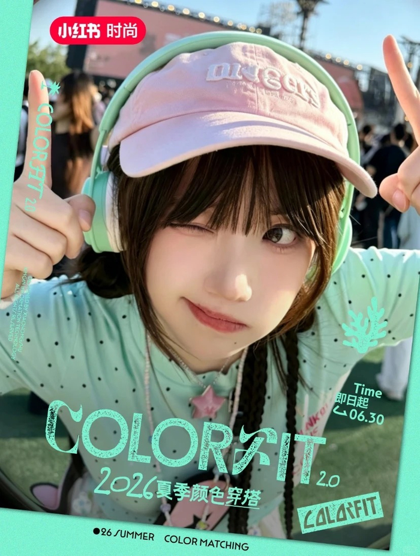
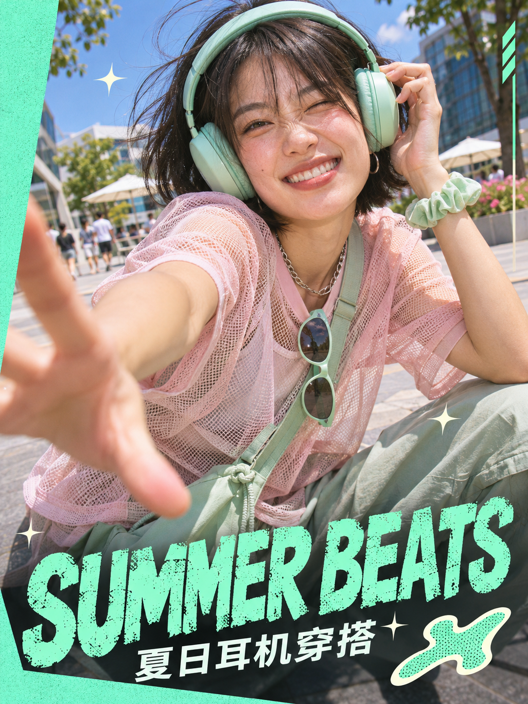
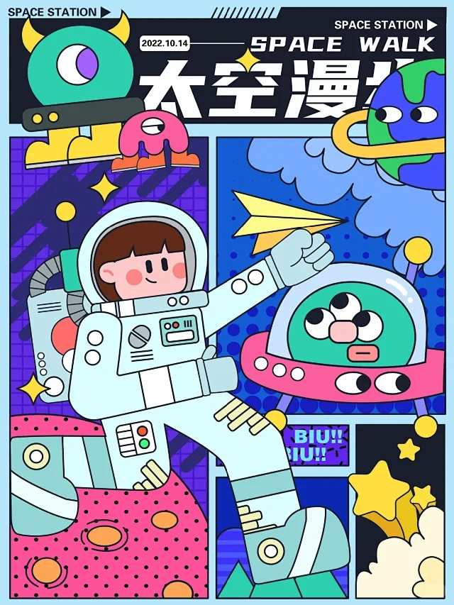
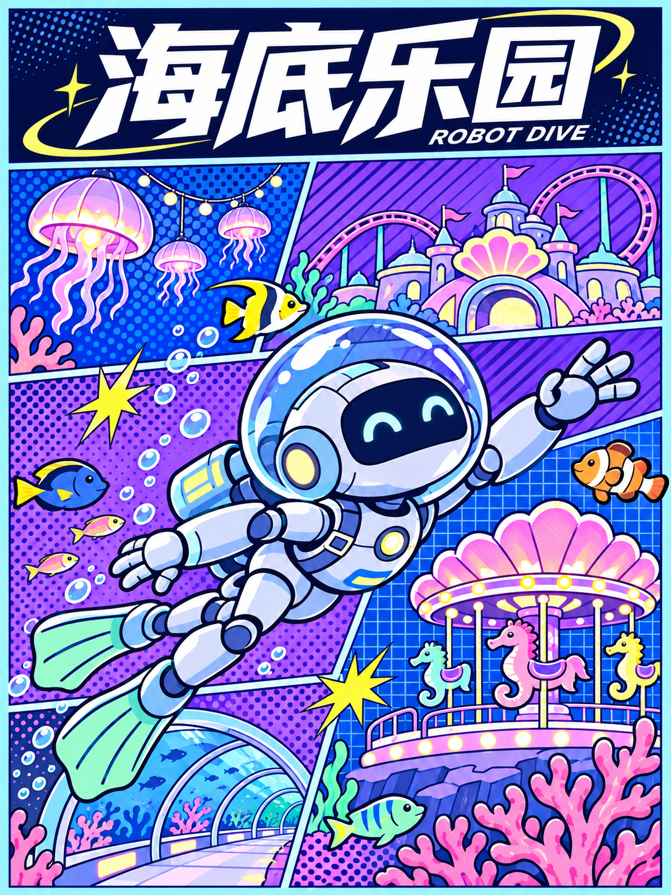

# Poster Style Studio · 海报风格工作室

[简体中文](#简体中文) · [English](#english) · [示例 / Examples](#poster-examples)

## 简体中文

Poster Style Studio（`poster-studio`）是一个 Agent Skill，用于从参考海报提取配色、字体气质、版式和图像质感，将它们存为具名的 JSON 风格档案，再用新主题和文案生成同风格海报。

### 安装与使用

1. 下载或克隆本仓库，将包含 [`SKILL.md`](SKILL.md) 的目录作为 `poster-studio` 安装到支持 Agent Skills 的宿主。使用 Codex 时，可将目录放在 `~/.codex/skills/poster-studio`。
2. 上传参考图，输入「`$poster-studio` 提取这张图的风格并保存」。
3. 输入「`$poster-studio` 列出海报风格」，或按下方示例用风格名称生成。

提取需要图像理解能力，生成需要宿主提供图像生成工具。风格库脚本使用 Python 3。跨会话保存自定义风格需要持久可写目录。

## English

Poster Style Studio (`poster-studio`) is an Agent Skill that turns a reference poster’s palette, typography, layout, and image treatment into a named JSON style profile. Reuse that profile to make posters with new subjects and copy.

### Install and use

1. Download or clone this repository and install the directory containing [`SKILL.md`](SKILL.md) as `poster-studio` in an Agent Skills-compatible host. For Codex, you can place it at `~/.codex/skills/poster-studio`.
2. Attach a reference image and ask “`$poster-studio` Extract and save the style of this poster.”
3. Ask “`$poster-studio` List saved poster styles,” or generate a poster by naming a style from the examples below.

Style extraction requires image understanding, and poster generation requires an image generation tool in the host. The style library script uses Python 3. Saving custom styles across sessions requires a persistent, writable directory.

## 示例 / Examples

### 示例一

> **你 / You**
>
> 
>
> **@Poster Studio** 参考图片作为视觉风格来源，用于提取其色彩逻辑、字体气质、版式骨架与标志性元素，形成风格保存到skill，用于类似风格的图片制作。 请给这个风格起一个独特的名字，用于生成时指定风格

**ChatGPT** · *Worked for 1m 20s*

**「薄荷斜拍贴报」**已存入本机 poster-studio 风格库，并验证可按名称读取。风格 ID 为 mint-tilt-snapshot，默认采用 3:4 竖版。

- 配色用高亮薄荷绿串起边框、标题和配饰，以奶油粉撞色，再用深色背景衬出亮字。
- 字体以带磨砂颗粒的超大英文展示字为主，搭配轻盈手写数字和窄体标签字。
- 版式让近距离广角人像几乎铺满画面，相框微微倾斜，标题叠在下三分之一，脸部保持清爽。
- 标志性元素包括伸向镜头的手势、侧边竖排字、斜贴标签和细颗粒薄荷边框。

> **你 / You**
>
> 用 **薄荷斜拍贴报** 风格做一张夏日耳机穿搭海报

**ChatGPT** · *Worked for 1m 42s*

**《SUMMER BEATS｜夏日耳机穿搭》**海报已完成。采用「薄荷斜拍贴报」风格，用倾斜的薄荷绿边框和颗粒大字衬托广角街拍，薄荷绿耳机与奶油粉上衣形成撞色。

---

### 示例二
> **你 / You**
>
> 
>
> **@Poster Studio** 参考图片作为视觉风格来源，用于提取其色彩逻辑、字体气质、版式骨架与标志性元素，形成风格保存到skill，用于类似风格的图片制作。 请给这个风格起一个独特的名字，用于生成时指定风格

**ChatGPT** · *Worked for 1m 20s*

**「霓彩轨道连环格」**已保存到 poster-studio 风格库，并验证可按名称读取。风格 ID 为 neon-orbit-panel-pop，默认采用 3:4 竖版。

- 配色用冰蓝统一边框和格缝，以钴蓝、电紫铺陈分格，再用亮黄、桃粉和薄荷青点亮局部。
- 字体以深色刊头上的超粗白色几何字为主，斜切笔画和宽字距的英文斜体带出复古科幻感。
- 版式上方设横向刊头，下方排大小不一的漫画格。浅色主角沿对角线跨过格缝，把视线带向右上。
- 标志性元素包括粗墨描边、圆润角色、波普网点、星芒、云团尾迹和拟声字小格。

> **你 / You**
>
> 用 **霓彩轨道连环格** 风格做一张机器人游海底乐园海报

**ChatGPT** · *Worked for 1m 43s*

**《海底乐园｜ROBOT DIVE》**海报已完成。采用「霓彩轨道连环格」风格，冰蓝机器人斜穿钴蓝与电紫漫画格，游过水母灯、珊瑚和海马旋转木马。粗白斜切标题和波普网点保留了复古科幻漫画的节奏。

